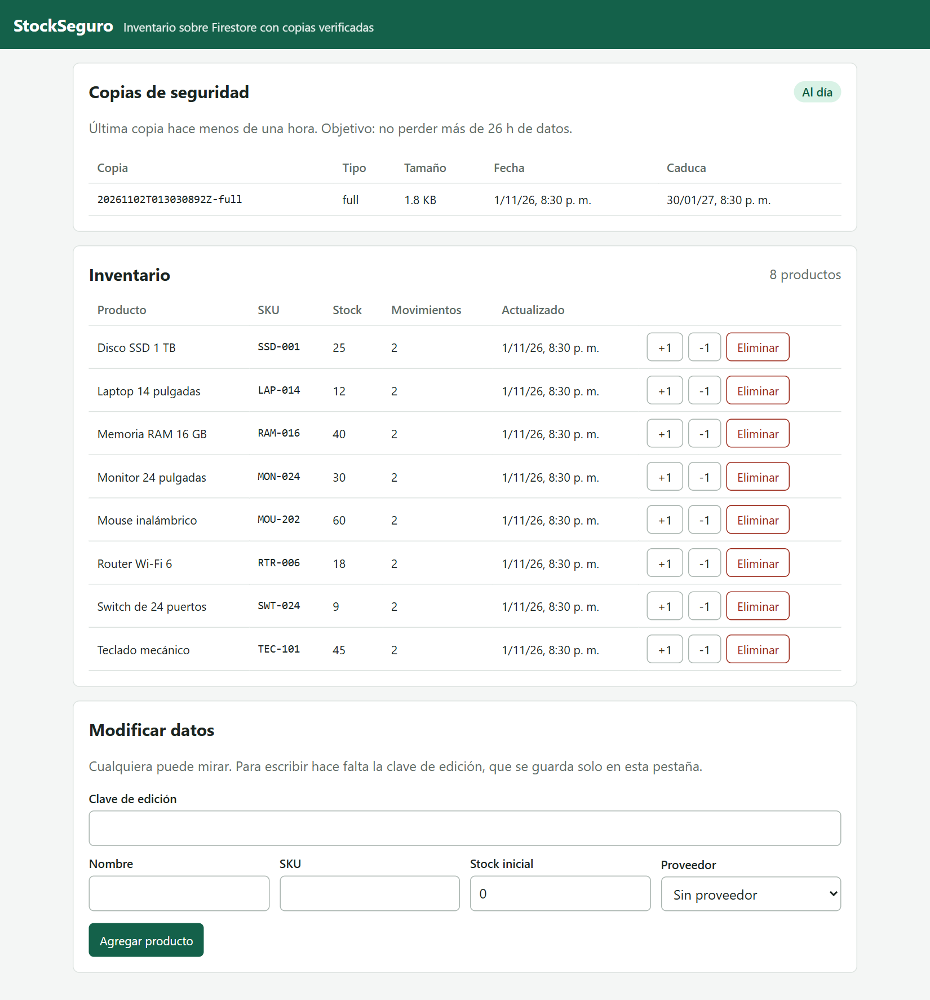
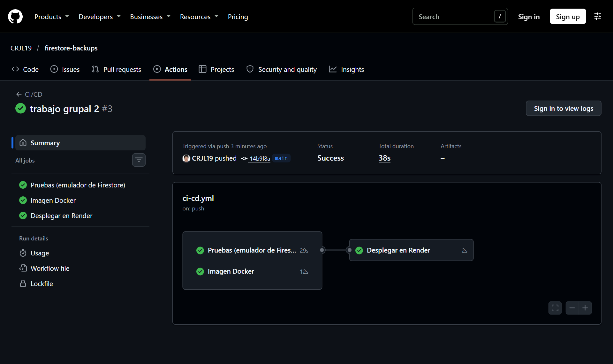
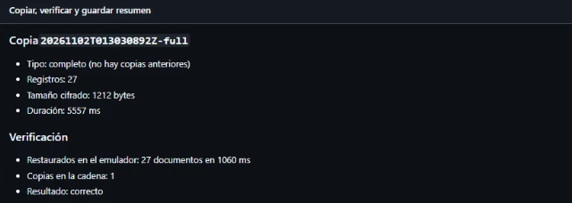

# Una copia que nadie restauró no es una copia: backups de Firestore verificados con GitHub Actions

**Autor:** Arturo Cutipa Flores
**Curso:** Base de Datos II · Universidad Privada de Tacna
**Actividad:** Estrategias de copia de seguridad NoSQL, desarrollada junto con Carlos Jimenez Laura

Casi todos los fallos de copias de seguridad se descubren el día que hace falta restaurar: el archivo está vacío, la clave se perdió o falta una parte. Así que nos propusimos una regla para este proyecto: **ninguna copia se guarda sin haberla restaurado antes**, y que lo haga una máquina todos los días, sin tocar producción ni gastar cuota.

Lo aplicamos en **StockSeguro**, un inventario sobre **Google Cloud Firestore**. Esto es lo que construimos.

## Enlaces del proyecto

- **Aplicación:** https://stockseguro-firestore.onrender.com
- **Repositorio público:** https://github.com/CRJL19/firestore-backups
- **Video:** `[enlace al video]`

## La aplicación y sus copias

StockSeguro guarda productos con sus movimientos en una subcolección. Está hecha con Node.js y Express, y corre en un contenedor Docker en Render. Firestore es una base NoSQL de documentos, y su exportación administrada exige un plan de pago, así que hacemos una copia lógica con el Admin SDK:

- **Completa cada 7 días:** recorre todas las colecciones y subcolecciones.
- **Incremental cada día:** lee lo cambiado según `updatedAt`, más las marcas que la app deja al borrar.
- **Formato:** registros NDJSON, comprimidos con gzip y cifrados con AES-256-GCM.

Para probarla en tu máquina no necesitas cuenta de Google, porque corre contra el emulador:

```bash
npm ci
npm run dev
```



## El recorrido de una copia

```
Cada día a las 03:00 (Perú)
   │
   ▼
GitHub Actions
   ├─ 1. Descarga las copias anteriores
   ├─ 2. Lee Firestore con una cuenta de solo lectura
   ├─ 3. Comprime y cifra
   ├─ 4. Restaura en un emulador y compara
   └─ 5. Solo si coincide, guarda el artifact
```

El orden es lo importante: una copia que no pasa el paso 4 nunca llega al 5, y el workflow falla a la vista.

## La verificación

El truco es que el emulador oficial de Firestore corre dentro del propio runner. Los pasos 2 y 4 son procesos separados, y el de verificación no recibe credenciales de producción:

```yaml
- name: Hacer la copia
  id: create
  env:
    FIREBASE_SERVICE_ACCOUNT: ${{ secrets.FIREBASE_BACKUP_SA }}
  run: node src/backup/cli.js create --dir backups --type "$BACKUP_TYPE"

- name: Verificar restaurando en el emulador
  env:
    BACKUP_ID: ${{ steps.create.outputs.id }}
  run: npx firebase emulators:exec --only firestore --project demo-stockseguro "node src/backup/cli.js verify --dir backups --id $BACKUP_ID"
```

La verificación borra la base de destino, restaura la cadena completa y compara dos cosas:

- **Una huella SHA-256 del contenido:** la de lo restaurado debe coincidir con la de la copia.
- **Los conteos reales del origen:** cada copia los guarda, y deben coincidir por colección.

Los conteos detectan lo que la huella no puede. Si alguien borra un documento desde la consola, la incremental no se entera, pero los números ya no cuadran y el workflow falla.

Como esa operación empieza borrando todo, el código se niega a ejecutarla fuera del emulador:

```javascript
if (!env.FIRESTORE_EMULATOR_HOST) {
  throw new Error('La verificación borra la base de destino: solo se ejecuta contra el emulador.');
}
```

## Dónde viven las copias

Las guardamos como artifacts de GitHub Actions. Las completas duran 90 días y las incrementales 30, porque estas dependen de aquellas:

```yaml
retention-days: ${{ steps.create.outputs.type == 'full' && 90 || 30 }}
```

Hay un detalle que condicionó el diseño: los artifacts de un repositorio público los puede descargar cualquier persona con cuenta de GitHub. **El cifrado no era opcional.** Usamos AES-256-GCM, que además autentica el contenido. Enlazamos cada archivo con su manifiesto, de modo que no se puede cambiar el de una copia por el de otra sin que se note, y una prueba lo comprueba.

El panel de la app lee el historial desde la API de GitHub y no desde Firestore. Si se pierde la base, el historial sigue visible.

## Permisos separados

Usamos dos cuentas de servicio:

- `backup-reader`, con el rol **Lector de Cloud Datastore**. Hace las copias a diario y no puede escribir.
- `stockseguro-app`, con el rol **Usuario de Cloud Datastore**. La usan la app y la restauración.

Si se filtrara la credencial del workflow diario, serviría para leer, pero no para borrar nada. Además, ninguna vive en el repositorio: están en los secrets de GitHub y en las variables de Render.

## Restaurar es una operación manual y con red

`restore.yml` solo se lanza a mano, pidiendo el ID de la copia y escribir `RESTAURAR`. Antes de tocar nada hace una copia del estado actual, para poder deshacer una restauración equivocada:

```yaml
- name: Copia del estado actual
  id: safety
  run: node src/backup/cli.js create --dir backups --type full --label prerestore
```

Permite restaurar toda la base o solo una rama, por ejemplo un único producto con sus movimientos. Después de restaurar deja una marca para que la siguiente copia automática sea completa, porque los documentos restaurados conservan su `updatedAt` antiguo y una incremental no los vería.

Backups y restauraciones comparten la misma cola de concurrencia, así que nunca corren a la vez:

```yaml
concurrency:
  group: backups
  cancel-in-progress: false
```

## El despliegue

Cada `git push` a `main` pasa por `ci-cd.yml`: 39 pruebas contra el emulador, construcción de la imagen Docker y una llamada al Deploy Hook de **Render**, un proveedor público en la nube. En `render.yaml` está `autoDeploy: false`, así que el único camino a producción pasa por las pruebas.

En nuestra última ejecución tardó 38 s: 29 s las pruebas, 12 s la imagen y 2 s el despliegue.



## Resultados

| Comprobación | Dónde | Resultado |
|---|---|---|
| Copia completa | Firestore real | 27 documentos en 5,6 s |
| Restauración de esa copia | Emulador en GitHub Actions | 27 documentos en 1,1 s, sin diferencias |
| Ejecución completa del workflow | GitHub Actions | 33 s |
| Copias diarias programadas | GitHub Actions, del 2 al 12 de noviembre | 11 de 11 en verde |
| Copia completa semanal | Automática | Creada sola el 9 de noviembre |
| Simulacro: copias, base vaciada y restauración | Emulador local | 25 documentos en 237 ms, los esperados |



El simulacro de desastre lo hicimos en el emulador local, con los mismos comandos del workflow. `restore.yml` está listo para producción, pero no lo ejecutamos para esta demostración.

Con estos volúmenes el tiempo de recuperación son segundos, pero no lo extrapolaría. Lo valioso es que cada verificación lo mide, así que veríamos crecer esa cifra junto con los datos.

## Lo que aprendimos en el camino

- **Un paso en rojo puede ser lo esperado.** La primera ejecución falló en el despliegue porque aún no existía el secret. Pasaron las pruebas y la imagen, y el mensaje decía exactamente qué faltaba.
- **La inspección visual sigue haciendo falta.** Las 39 pruebas pasaban, y aun así un navegador en tamaño de celular mostró la página desbordada 184 píxeles: un texto oculto para lectores de pantalla se salía de la tabla.
- **Las dependencias externas fallan.** Una consulta a la API de GitHub falló una vez, con la causa sin confirmar. El panel mostró «No disponible» en lugar de «sin copias», que habría sido falso, y se recuperó solo.

## Limitaciones

- **Dos ubicaciones, no tres.** Hay datos en Firestore y copias en GitHub. La regla 3-2-1 pediría una tercera.
- **Horario de GitHub.** Una tarea programada puede retrasarse, y lo comprobamos: programada para las 08:00 UTC, la copia empezó cada día entre 6 y 10 horas tarde. Además, GitHub desactiva las tareas programadas tras 60 días sin actividad en el repositorio. Por eso el panel avisa si la última copia supera las 26 horas.
- **Plan gratuito.** Firestore Spark permite 50 000 lecturas y 20 000 escrituras al día. La instancia de Render se duerme tras un rato sin tráfico.
- **Escala.** Cada copia se procesa en memoria. Para millones de documentos, lo correcto sería la exportación nativa.

## Conclusión

Lo que cambió fue dónde ponemos la confianza. Ya no decimos «tenemos copias», sino «cada copia guardada se restauró antes y coincidió». Y gracias al emulador, esa comprobación no cuesta nada.

Para saber por qué exportar JSON no basta en una base NoSQL, recomiendo el artículo de Carlos.
