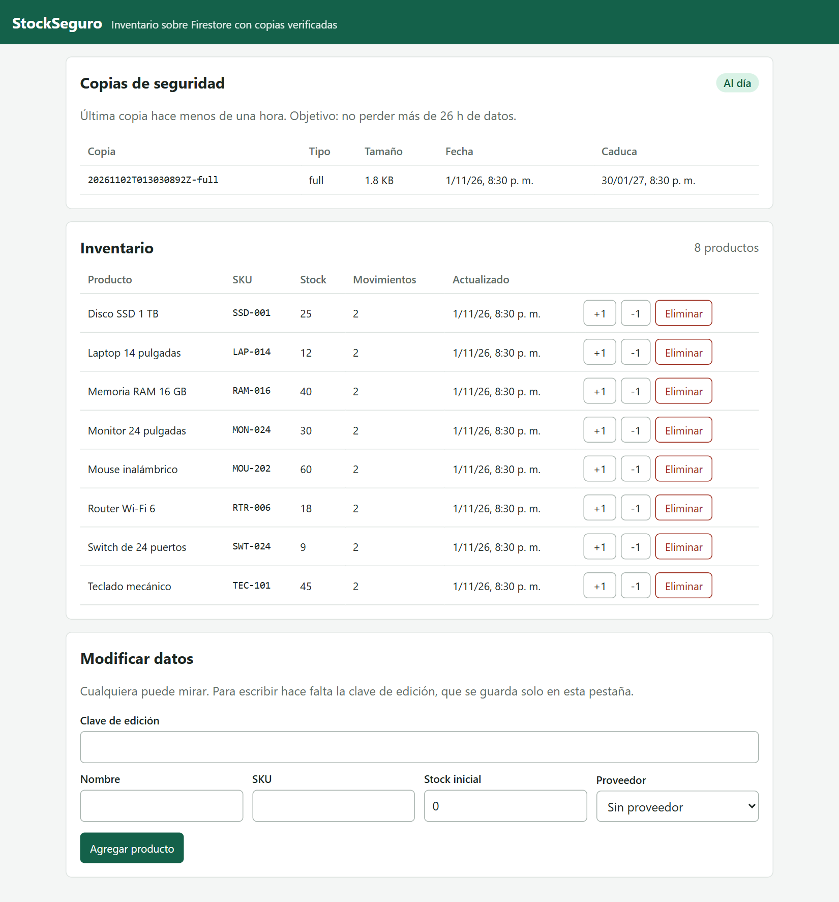
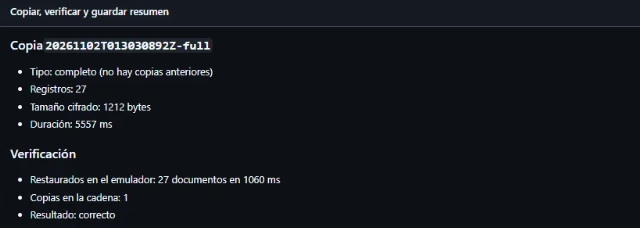

# Copiar una base NoSQL no es exportar JSON: lo que aprendimos haciendo backups de Firestore

**Autor:** Carlos Jimenez Laura
**Curso:** Base de Datos II · Universidad Privada de Tacna
**Actividad:** Estrategias de copia de seguridad NoSQL, desarrollada junto con Arturo Cutipa Flores

En PostgreSQL ejecutas `pg_dump` y obtienes un archivo que recrea la base. En Firestore, con el plan gratuito, no existe un equivalente: la exportación administrada exige un plan de pago y un bucket de Cloud Storage. La idea obvia es leer todos los documentos y guardarlos como JSON, y esa copia parece correcta hasta que intentas restaurarla.

En este artículo cuento qué se pierde con esa idea y cómo lo resolvimos en **StockSeguro**, un inventario con copias automáticas, cifradas y comprobadas.

## Enlaces del proyecto

- **Aplicación:** https://stockseguro-firestore.onrender.com
- **Repositorio público:** https://github.com/CRJL19/firestore-backups
- **Video:** `[enlace al video]`



## Las opciones que teníamos

| Opción | A favor | En contra para este proyecto |
|---|---|---|
| Exportación administrada | Oficial y apta para grandes volúmenes | Plan de pago y bucket de Cloud Storage |
| PITR y copias programadas | Recuperación muy precisa | Plan de pago, y la copia sigue dentro de Google |
| Copia lógica con el Admin SDK | Gratuita, con cifrado propio y fuera de Google | Hay que resolver todo lo que sigue |

Elegimos la copia lógica porque era lo posible con nuestro presupuesto, no porque sea la mejor en general. Para una base grande en producción, recomendaría la nativa.

## Cuatro formas de perder datos sin enterarte

### 1. JSON no conoce los tipos de Firestore

Un documento nuestro tiene un `Timestamp`, un `GeoPoint` y una referencia a su proveedor. `JSON.stringify` los convierte en objetos corrientes, y al restaurar ya no son esos tipos. La referencia deja de ser una referencia y ninguna consulta por fecha vuelve a funcionar.

Por eso cada tipo especial se guarda con una etiqueta:

```javascript
if (value instanceof Timestamp) return { $ts: [value.seconds, value.nanoseconds] };
if (value instanceof GeoPoint) return { $geo: [value.latitude, value.longitude] };
if (value instanceof DocumentReference) return { $ref: value.path };
```

Y hay una decisión deliberada al final de esa función: un tipo desconocido lanza un error. Prefiero que falle la copia a que parezca correcta y le falten datos.

### 2. Las subcolecciones no vienen con su padre

Leer `products` no trae `products/{id}/movements`. Hay que recorrerlas. Y hay un caso peor: una subcolección puede colgar de un documento que ya no existe. Firestore lo llama documento fantasma, y un `collection.get()` no lo devuelve, así que sus hijos quedarían fuera.

`listDocuments()` sí los incluye:

```javascript
const refs = await collection.listDocuments();
for (const ref of refs) {
  const subcollections = await ref.listCollections();
  for (const subcollection of subcollections) await walk(subcollection);
}
```

Una de nuestras pruebas crea justo ese caso, borra todo, restaura y comprueba que el hijo volvió.

### 3. Una copia que tarda no es una foto

Si la app sigue escribiendo mientras copias, puedes guardar un producto de hace un minuto con los movimientos de ahora. Resolvimos esto leyendo los documentos dentro de una transacción de solo lectura, de modo que todo corresponde a un mismo instante:

```javascript
return db.runTransaction(async (transaction) => {
  const snapshot = await transaction.get(collection);
  // ...
}, { readOnly: true });
```

### 4. Un borrado no deja rastro

La copia incremental lee lo que cambió según `updatedAt`, pero un documento borrado ya no tiene ese campo: simplemente deja de existir, y la consulta no puede verlo. Sin más, al restaurar reaparecerían productos eliminados.

Por eso la app deja una marca en la misma operación que borra:

```javascript
batch.set(db.collection('_tombstones').doc(tombstoneId), {
  path: ref.path,
  deletedAt: FieldValue.serverTimestamp(),
});
batch.delete(ref);
await batch.commit();
```

## La estrategia completa

- **Copia completa cada 7 días**, que corrige cualquier desviación acumulada.
- **Copia incremental diaria**, que gasta menos cuota porque lee menos documentos.
- **Restauración selectiva:** `--only products/abc123` recupera un producto y sus movimientos sin tocar el resto.
- **Cifrado AES-256-GCM,** necesario porque los artifacts de un repositorio público se pueden descargar con cualquier cuenta de GitHub.
- **Objetivo de pérdida (RPO):** 24 horas. El panel de la app avisa si la última copia supera las 26.

Restaurar una incremental significa aplicar la cadena en orden: la completa y luego cada incremental. Dentro de cada copia, los borrados se aplican antes que los documentos, porque un documento presente en una copia existía al hacerla, aunque se hubiera borrado y creado de nuevo.

## El problema que no se resuelve del todo

La copia incremental depende de un contrato: todo se escribe a través de la app, con `updatedAt` y sus marcas de borrado. Alguien que borre un documento desde la consola de Firebase lo rompe, y la incremental no se entera.

No pudimos evitarlo, pero sí detectarlo. Cada copia guarda los conteos reales del origen con consultas de agregación, que son baratas. Si al restaurar los números no coinciden, la verificación falla:

```
products: la copia dice 1 y la restauración tiene 2
```

Una prueba automática reproduce ese caso. La solución entonces es una copia completa. Queda un hueco que prefiero admitir: una modificación externa que no cambie los conteos solo se recoge en la siguiente completa.

## Cómo se publica y se automatiza

El código está en un repositorio público de GitHub, y todo se ejecuta con **GitHub Actions**:

- Cada `git push` ejecuta las 39 pruebas contra el emulador de Firestore, construye la imagen Docker y despliega en **Render**, un proveedor público en la nube.
- Cada día, a las 03:00 hora de Perú, un workflow hace la copia, la restaura en un emulador y solo si coincide la guarda.

Las copias se hacen con una cuenta de servicio de solo lectura, y la base está en **Firestore**, sobre Google Cloud.

## Resultados

En producción, con Firestore real, la primera copia completa dio esto:

| Medición | Resultado |
|---|---|
| Documentos copiados | 27 (8 productos, 3 proveedores y 16 movimientos) |
| Tamaño cifrado | 1212 bytes |
| Duración de la copia | 5,6 s |
| Restauración en el emulador | 27 documentos en 1,1 s |
| Resultado de la verificación | Correcta |



Después dejamos el workflow funcionando solo. Del 2 al 12 de noviembre se ejecutó todos los días y guardó 12 copias, todas verificadas antes de guardarse: 2 completas, la segunda creada automáticamente al cumplirse los 7 días, y 10 incrementales. Cada incremental cifrada pesa unos 650 bytes, frente a 1,8 KB de una completa.

El simulacro de desastre lo hicimos en el emulador local, con los mismos comandos que usa GitHub Actions: una copia completa, un cambio de stock y un borrado, una incremental, la base vaciada y la restauración de la cadena. Volvieron los 25 documentos esperados en 237 ms, con el stock actualizado y sin el producto eliminado. En producción, la restauración existe como un workflow manual, pero no la ejecutamos para esta demostración.

Un dato que me sorprendió: esa incremental, hecha segundos después de la completa, copió 26 registros frente a 27. No es un error. Cada incremental relee los últimos 5 minutos por seguridad, porque copiar de más es inofensivo y copiar de menos no lo es. El ahorro aparece cuando las copias están separadas por horas.

## Limitaciones

- **Dos ubicaciones, no tres.** Hay datos en Firestore y copias en GitHub. La regla 3-2-1 pediría una tercera.
- **Enteros y decimales.** El SDK de JavaScript no distingue `1` de `1.0`. Tampoco se conservan `createTime` ni `updateTime`, que asigna el servidor.
- **Memoria.** Cada copia se procesa completa en memoria, adecuado para miles de documentos, no para millones.
- **La clave de cifrado.** Si se pierde, las copias no sirven de nada, así que hay que guardarla también fuera de GitHub.

## Qué me llevo

En una base relacional el esquema y la herramienta de volcado resuelven casi todo por ti. En NoSQL, el esquema vive en la aplicación, y por eso la estrategia de copia también: tuvimos que cambiar cómo borra la app para poder copiar bien.

Lo otro que me llevo es desconfiar de una copia hasta verla restaurada. Mi compañero Arturo cuenta en su artículo cómo automatizamos esa comprobación.
